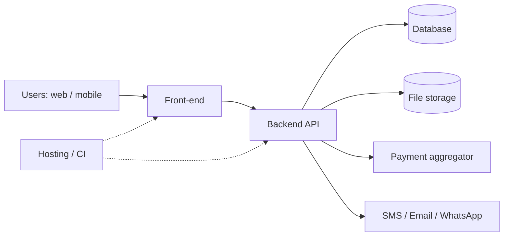
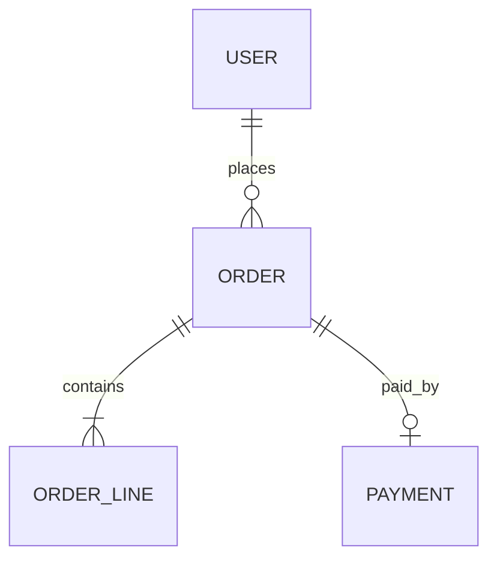

# Documentation Standard

Every project ships a `/docs` folder with the files below. Each file has one audience and one job. A person who has never seen the project (developer or not) must be able to launch it, understand it, change it and keep it alive using only these files.

**Core set (mandatory):** README · QUICKSTART · FULL_DOCUMENTATION · DB_SCHEMA · DESIGN_CHOICES
**Maintenance set (mandatory once in production):** SERVICES_AND_ACCOUNTS · RUNBOOK · CHANGELOG · DECISIONS
**Optional (add when relevant):** API_REFERENCE · USER_GUIDE · TESTING · CONTRIBUTING · ROADMAP · GLOSSARY · COMPLIANCE

---

## Writing rules (all files)

- Plain language first; technical detail second, in a clearly marked block. A non-technical owner must be able to read the first paragraph of every section.
- One screenshot or diagram per concept that has a shape (architecture, flow, schema, screen). Diagrams as Mermaid in the markdown plus an exported PNG in `/docs/img`.
- Every command is copy-pasteable, one per line, with the expected result stated underneath.
- Every file starts with: purpose (one line), audience, last updated date, owner.
- No secrets in docs. Reference the secret's name and where it lives.
- Dates in DD/MM/YYYY; versions follow semver; environment names are exactly `local`, `staging`, `production`.
- Update the doc in the same commit as the change it describes. Docs that drift are deleted, not kept.
- Keep each file under ~2 000 words; split into a sub-folder when longer.
- French or English: pick one per project and keep it; UI strings are quoted in the product language.

---

## Core set

### README.md (repo root) — entry point, 1 page
Audience: everyone.
1. What the product is, in two sentences, and who uses it.
2. Status badge line: version, environment URLs (staging / production), health.
3. Table linking every doc below with one line each.
4. Who to contact (name, role, channel).

### QUICKSTART.md — launch and deploy
Audience: a new developer on day one; a non-technical owner who must redeploy.
1. **Prerequisites** — tools and versions (Node, Python, Flutter, Docker…), accounts needed, with install links.
2. **Get the code** — clone command, branch to use.
3. **Configure** — copy `.env.example` → `.env`; table of every variable: name, what it is, where to get it, example value (fake).
4. **Run locally** — the exact commands, expected output, the URL to open, a test login.
5. **Deploy** — the chosen platform and why in one line, then the exact steps:
   - Website / landing page → static host (Vercel, Netlify, Cloudflare Pages): connect repo, set env vars, push to `main`.
   - Web app with backend → Railway / Render / Fly.io / VPS with Docker Compose: build command, start command, database provisioning, domain, SSL.
   - Mobile app → Expo EAS or Fastlane: build profiles, store credentials location, submission steps, review checklist, OTA update command.
6. **Verify** — what to check after deploy (URL loads, login works, one transaction passes, logs clean).
7. **Rollback** — the one command or click that restores the previous version.
8. **Common problems** — table: symptom → cause → fix.

### FULL_DOCUMENTATION.md — the whole project
Audience: developers; owners read sections 1–3.
1. **Overview** — problem solved, users, key numbers (users, transactions, volumes).
2. **Visual architecture** — one diagram: clients (web/mobile), backend/API, database, storage, third-party services (payments, SMS, email, maps), hosting. Arrows labelled with protocol/purpose. Then one paragraph per box.
3. **Screens & flows** — screen map (Mermaid), then each main flow (sign-up, order, payment, admin) as numbered steps with screenshots.
4. **Features** — one sub-section per feature: what it does, who can use it, business rules, edge cases, where the code lives (folder/file).
5. **Roles & permissions** — matrix: role × action.
6. **Security** — authentication method, session/token lifetime, password/OTP rules, data encryption at rest/in transit, secrets management, rate limiting, audit logs, backup encryption, what a compromised key means and how to rotate it.
7. **Data & privacy** — what personal data is stored, where, for how long, how it is deleted on request, consent points.
8. **Integrations** — per service: purpose, environment (sandbox/live), credentials name, webhook URLs, failure behaviour.
9. **Configuration & environments** — differences between local/staging/production; feature flags.
10. **Performance & limits** — expected load, known limits, caching, quotas of third-party services.
11. **Code structure** — folder tree with one line per folder; naming conventions; how to add a feature end-to-end.
12. **Known issues & technical debt** — list with owner and severity.

### DB_SCHEMA.md — the data, visually
Audience: developers and analysts; owners read the first two sections.
1. **In one sentence per table** — what each table represents in business terms ("`orders` = one customer purchase").
2. **Diagram** — Mermaid `erDiagram` with all tables, primary keys, foreign keys, cardinalities; exported PNG alongside.
3. **Table reference** — per table: column, type, meaning in plain words, required/optional, example, constraints. Mark personal data columns with `[PII]` and money columns with currency and unit (integer minor units or decimal).
4. **Relationships explained** — one line per relationship in business language ("one order has many order lines").
5. **Enumerations & statuses** — every status value and what triggers the transition; a state diagram for order/payment/user status.
6. **Indexes & performance notes** — which queries the indexes serve.
7. **Migrations** — tool used, how to create, apply and roll back a migration; naming rule.
8. **Seed & test data** — how to load it; the test accounts.
9. **Backups** — frequency, location, retention, how to restore (exact commands), last restore test date.

### DESIGN_CHOICES.md — why it looks and behaves this way
Audience: designers, developers, owners.
1. **Domain & tone** — which preset was applied (from `design_skill.md`: tech/banks, restaurant/casual, non-profit, luxury/gallery) and the one-line intent.
2. **Tokens** — fonts, type scale, palette with hex and role, spacing, radius, icon library, motion durations; link to the token file in code.
3. **Layout rules** — page structure used, navigation model (desktop/mobile), breakpoints, primary CTA placement.
4. **Component rules** — buttons, forms, tables, accordions, sheets: sizes and states, with one screenshot each.
5. **Conversion decisions** — onboarding choice (none / intent questions / benefit screens / progressive), checkout model, payment order, pricing structure, proof placement — each with the rule applied and any local test result.
6. **Accessibility & localisation** — contrast, target sizes, languages, formats, low-bandwidth measures.
7. **What was deliberately not done** — rejected options and the reason in one line each.
8. **Open questions / to test** — hypotheses waiting for data.

---

## Maintenance set

### SERVICES_AND_ACCOUNTS.md — who owns what (the hand-over file)
Audience: owner and successors. The most important file for continuity.
Table with one row per external service (domain registrar, DNS, hosting, database, email/SMS provider, payment aggregator, app stores, analytics, error tracking, source control, CI):
service · purpose · account owner (person + email) · login location (password manager entry name, never the password) · billing (card/owner, monthly cost, renewal date) · plan/tier · what breaks if it lapses · how to transfer ownership.
Plus: list of API keys by name and where they are stored; list of people with admin access and their role; calendar of renewals.

### RUNBOOK.md — operating the product
Audience: whoever is on duty.
1. Daily/weekly checks (uptime, error rate, payment success rate, backups completed).
2. Monitoring & alerts — tools, what each alert means, who receives it.
3. Incident procedure — detect → assess → communicate (template message to users) → fix → post-mortem template.
4. Standard operations, each as numbered steps: deploy, rollback, rotate a secret, restore a backup, add an admin, refund a payment, reconcile mobile-money settlements, handle a store rejection, scale up.
5. Support playbook — top 10 user problems and their answers.
6. Contacts — hosting, payment provider, telco support lines, with hours.

### CHANGELOG.md
Keep a Changelog format. One entry per release: version, date, Added / Changed / Fixed / Removed / Security, migration notes, who deployed.

### DECISIONS.md — decision log (lightweight ADRs)
One entry per significant technical or product decision: date · decision · context · options considered · consequence · status. New entries at the top. Never edit past entries; supersede them.

---

## Optional set

- **API_REFERENCE.md** — base URL per environment, auth, one block per endpoint (method, path, params, example request/response, errors), webhooks, rate limits. Generate from OpenAPI where possible and link the spec.
- **USER_GUIDE.md** — for end users and support staff: task-based ("How to place an order", "How to refund"), one screenshot per step, FAQ. Written in the product language.
- **TESTING.md** — how to run unit/integration/e2e tests, coverage expectations, manual test checklist before release (the design_skill mobile checklist included), test accounts and test payment numbers.
- **CONTRIBUTING.md** — branch model, commit message format, PR template, code style, review rules, definition of done.
- **ROADMAP.md** — now / next / later; one line per item with owner; linked to issues.
- **GLOSSARY.md** — business and technical terms in both languages (e.g. "code marchand", "settlement", "KYC").
- **COMPLIANCE.md** — data-protection basis, consent texts, retention schedule, accessibility conformance statement, terms & privacy policy locations, regulator requirements (banking, payments).

---

## Templates

Each file begins with this header:

```
# <Title>
Purpose: <one line>
Audience: <who>
Last updated: DD/MM/YYYY — Owner: <name, role>
```

Architecture diagram skeleton (Mermaid):



Schema skeleton (Mermaid):



---

## Review checklist (before hand-over or release)

- A stranger launched the project locally using only QUICKSTART.md.
- A non-technical person redeployed or rolled back using only QUICKSTART.md.
- Every service in SERVICES_AND_ACCOUNTS.md has an owner, a login location and a renewal date.
- A backup restore was performed and dated in DB_SCHEMA.md.
- Every diagram matches the current code.
- No secret appears in any doc.
- CHANGELOG has an entry for the current version.
